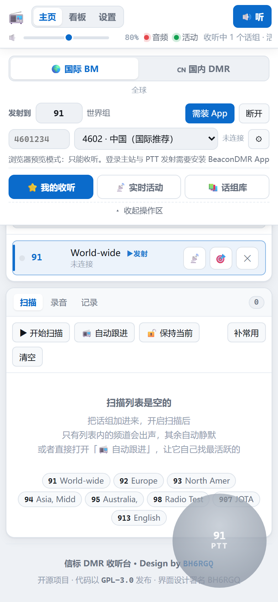
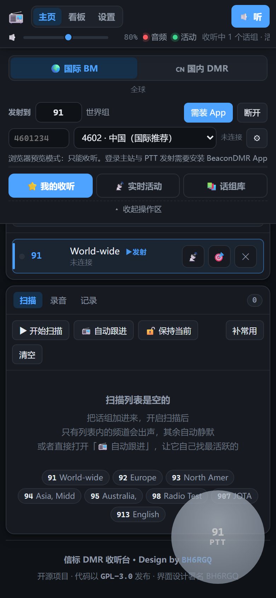
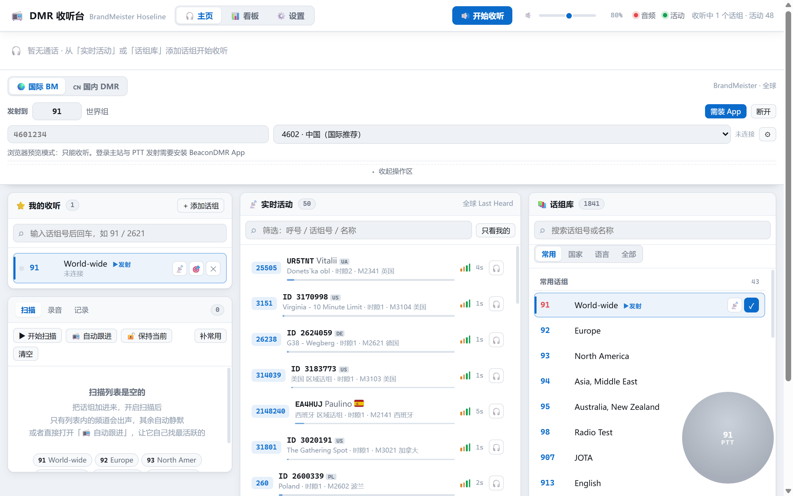

# 信标 DMR 收听台 · Beacon DMR

> 一个跑在 Android 上的 DMR（数字移动无线电）收听与发射客户端。
> 整个界面是一个自包含的单文件 HTML，原生层只负责补 WebView 补不了的那几件事。

[](LICENSE)
-green.svg)

[](https://github.com/Honest16888/Beacon-DMR/releases/latest)

<p align="center">
  
  
</p>

**[⬇ 下载最新 APK](https://github.com/Honest16888/Beacon-DMR/releases/latest)** ·
[全部版本](https://github.com/Honest16888/Beacon-DMR/releases) ·
不需要编译，装到 Android 8.0+ 的手机上即可

---

## 这是什么

业余无线电的 DMR 网络（BrandMeister、TGIF、XLX、国内 radiowo 等）会把每个话组的
语音实时推到互联网上。本项目把这条链路做成了一个手机 App：

- **收听**：订阅任意话组，语音从主站 WebSocket 流里拉下来直接播，带语音波纹、录音、
  扫描、屏蔽名单
- **发射**：按 MMDVM / Homebrew 协议登录主站，麦克风 → AMBE 编码 → DMRD 包 → 主站，
  也就是说这台手机可以当一台热点用

界面同时支持**国际 BrandMeister**（HOSE 流）和**国内 China DMR**（radiowo）两套网络，
在首页顶部一键切换，订阅列表各自独立保存。

## 特性

**收听**

- 话组订阅、实时活动流、话组库三栏，手机端一次显示一栏
- 语音波纹（VU）+ 抖动缓冲，网络抖动不卡顿
- 自动录音，WAV 落到公共音乐目录
- 扫描模式：轮流守听一批话组，可自动跟进最活跃的那个
- 接收过滤：只收当前话组 / 屏蔽名单 / 单独静音某话组
- **个呼与组呼同时开启**：组呼收听中也能收到点名呼我的个呼，顶部主显示区与
  折叠摘要条都会切成「个呼 · 对方 ID」，并给一个「回复」按钮（自动带上对方 ID、
  个呼标志和收到的时隙）
- 内嵌 15500+ 条中国台站数据（来自 RadioID.net），离线也能查呼号

**发射**

- 完整 MMDVM 登录流程：RPTL → RPTK → RPTC → RPTACK，逐字节对齐 MMDVMHost
- AMBE+2 编码走 DroidStar 的声码器插件，FEC 链（RS129 / BPTC / Golay / Hamming）
  在 native 侧实现
- 发射前端链：280 Hz 二阶高通 → 2 kHz presence → AGC → 噪声门，
  顺序和参数都有仿真脚本守着（见「测试」）
- 主站可选内置表，也可以**自己添加**（host[:port]，存在本机，一键切换）
- 操作区的话组名可以点一下改成自己的叫法，覆盖话组表里的名字
- PTT 可拖动到屏幕任意位置，位置自动保存
- 发射失败按阶段给结论：ID 被占 / 密码错 / 呼号不符 / 被同 ID 顶掉，四种情况
  给完全不同的排查建议
- 发射健康度日志：每 5 秒报「处理 平均 X ms / 峰值 Y ms（预算 20 ms）」，
  峰值超预算会标 ⚠ —— 用来判断「断续」到底在发射端还是网络侧

**界面**

- 浅色 / 深色 / 跟随系统
- 手机、平板、桌面自适应；首页操作区可手动折叠，滚回顶部自动展开
- 零第三方依赖：没有 androidx，没有前端框架，没有 CDN

## 截图

<p align="center">
  
</p>

## 架构

```
┌─────────────────────────────────────────────────────────┐
│  web/dmr-listener.html          单文件前端（约 820 KB）   │
│  布局 + 全部业务逻辑 + 内嵌台站数据，无构建步骤           │
└───────────────┬─────────────────────────────────────────┘
                │  @JavascriptInterface（JSON 事件回调）
┌───────────────┴─────────────────────────────────────────┐
│  MainActivity.java              WebView 外壳（683 行）    │
│  ① https 源 ② 自动播放 ③ WAV 落盘 ④ WakeLock            │
├─────────────────────────────────────────────────────────┤
│  DmrEngine        门面：把下面几个串起来，对界面只暴露动作  │
│  MmdvmSession     MMDVM / Homebrew UDP 协议（1804 行）    │
│  DmrRx            接收：DMRD 包 → PCM                     │
│  DmrTransmitter   发射：麦克风 → 声码器 → DMRD 包          │
│  DmrAudio         播放：抖动缓冲 + AudioTrack             │
│  DmrDirectory     RadioID.net 呼号查询                    │
├─────────────────────────────────────────────────────────┤
│  cpp/beaconvoc.so              JNI 原生层                 │
│  vocoder_jni.cpp   dlopen 声码器插件 + 编解码 + 自检       │
│  dmrtx_jni.cpp     DMR 帧组装（LC + BPTC + RS129 + Golay） │
│  fec/              G4KLX/MMDVMHost 的 FEC 实现            │
├─────────────────────────────────────────────────────────┤
│  jniLibs/libdsvocoder.so       DroidStar 声码器（预编译）  │
└─────────────────────────────────────────────────────────┘
```

### 为什么是单文件 HTML

界面约 820 KB，全在一个 `.html` 里，**没有构建步骤**——改完存盘刷新就是最新界面。

这个选择有代价（文件巨大、没有类型检查），但换来的是：整个 UI 层可以直接用浏览器
打开调试，DevTools 里改一行 CSS 立刻见效，不需要 webpack / vite 那一套。对一个
个人维护的项目来说，这个取舍是划算的。

原生层只做四件 WebView 做不到的事，刻意不引入任何第三方依赖：

1. **允许无用户手势的自动播放** —— 话组一有语音就得响
2. **让页面跑在真正的 https 源上** —— `file://` 是不透明源，`localStorage` 会抛
   `SecurityError`，而话组订阅、主题、音量全靠它
3. **把录音 WAV 落到公共音乐目录** —— WebView 里 `a[download]` 静默失效
4. **收听期间持 Partial WakeLock** —— 熄屏后 WebAudio 的调度不被掐断

## 快速开始

### 直接安装（推荐）

去 [Releases](https://github.com/Honest16888/Beacon-DMR/releases/latest) 下载最新的
`beacon-dmr-x.y-release.apk`，装到 Android 8.0+ 的手机上。

**收听开箱即用**，不需要任何配置。发射要先在 BrandMeister SelfCare 里把这个 DMR ID
登记为热点、设置热点安全密码，并且你得持有有效的业余无线电操作证书。

历史版本（v1.0 起）都保留在 [Releases](https://github.com/Honest16888/Beacon-DMR/releases)，
每个包附了 SHA-256。

### 网页版（只能收听）

```bash
# 起个本地静态服务（比 file:// 干净，localStorage 行为一致）
python -m http.server 8000
# 打开 http://localhost:8000/web/dmr-listener.html
```

浏览器里能完整收听、录音、切换网络。**发射不可用**——麦克风采集和 MMDVM 协议
在 native 层，页面会显示「需装 App」。

### Android（可发射）

> [!IMPORTANT]
> **不要把仓库放在含中文的路径下**（比如 `桌面/新建文件夹`）。
> AGP 调 `cmake.exe` 时，路径含中文会让 CMake 在**配置阶段直接崩溃**，
> 退出码 `0xC0000409`（STATUS_STACK_BUFFER_OVERRUN）。实测 CMake 3.22.1 和 3.31.6
> 都崩，换版本无效，纯 ASCII 路径下一次通过。
>
> 建议 clone 到 `D:\dev\beacon-dmr` 这类纯英文路径。

**环境**

| 项 | 版本 |
|---|---|
| JDK | 17 |
| Android SDK | compileSdk 34 / minSdk 26 |
| NDK | 26.1.10909125 |
| CMake | 3.22.1 |
| Gradle | 8.7（wrapper 自带） |
| AGP | 8.5.2 |

**构建**

```bash
git clone https://github.com/Honest16888/Beacon-DMR.git
cd Beacon-DMR

# 1. 指向你的 SDK（或者设 ANDROID_HOME 环境变量）
echo "sdk.dir=/path/to/Android/Sdk" > android/local.properties

# 2. 一键构建（自动同步前端 → gradlew → 产物拷到 dist/）
bash tools/build_apk.sh
```

产物在 `dist/beacon-dmr-release.apk`。

**关于签名**：`android/keystore.properties` 不在仓库里（密钥泄漏等于任何人都能签出
可覆盖安装的更新包）。不提供这个文件也能构建，只是产出未签名包。要签自己的名：

```bash
cp android/keystore.properties.example android/keystore.properties
keytool -genkeypair -v -keystore android/beacon-dmr.jks -alias beacon-dmr \
        -keyalg RSA -keysize 2048 -validity 10000
# 然后按 example 里的说明填好四个字段
```

## 目录结构

```
beacon-dmr/
├── web/
│   └── dmr-listener.html        前端唯一真源（改这个）
├── android/
│   ├── app/src/main/
│   │   ├── assets/index.html    ← 构建时从 web/ 同步，不要手改
│   │   ├── java/net/beacon/dmr/  Java 层
│   │   ├── cpp/                 JNI + FEC
│   │   └── jniLibs/             声码器插件（预编译，必需）
│   └── keystore.properties.example
├── third_party/
│   └── droidstar-vocoder-plugin/ 声码器插件原件 + 接口头文件
├── tools/
│   ├── build_apk.sh             一键构建
│   ├── gen_cn_db.py             从 RadioID.net 重新生成中国台站数据
│   └── verify_apk.py            核对 APK 里的 dex 和 assets
├── tests/
│   ├── smoke_cn.js              CDP 冒烟测试（166 项断言）
│   ├── smoke_ui.js              CDP 交互测试（63 项断言：收听 / 折叠 / 多话组）
│   ├── tx_chain_sim.py          发射前端链路仿真（新旧链对比 + 电平扫描）
│   ├── tx_filter_resp.py        发射滤波器频响计算
│   └── check_html.py            单文件 HTML 的静态检查
└── docs/
    ├── 实现说明.md              完整开发日志，3400 行，按问题逐条记录
    ├── 决策备忘.md              早期技术选型
    └── DroidStar-逆向分析.md    对上游 App 的协议逆向笔记
```

## 实现笔记

`docs/实现说明.md` 里有 3400 行的完整踩坑记录，`docs/发射音质.md` 是发射前端的
排查记录（v2.0 → v2.1）。这里挑几个最值得看的：

**ESSID 映射和 DroidStar 差一位** —— 登录一直 `MSTNAK`。MMDVM 协议里 ESSID 0 表示
「不用别名」，但两边的映射表错开一位，填 0 实际发出的是 1，主站查不到这台热点。
对照 DroidStar 的字节流才发现。

**`softwareId` / `packageId` 被 BrandMeister 校验** —— 这两个字段在协议文档里写的是
「可填 0」，实际会被校验。填错时表现是登录到最后一步被拒，没有任何错误信息。

**经度字段多了一位小数** —— 配置报文里经度按 `度 × 10⁷` 的整数传，多乘了一次 10，
主站认为坐标非法，回 `MSTNAK`。

**源端口必须固定** —— `RPTC` 阶段被拒，因为每次发包换了源端口。主站按「ID + 源端口」
认这条会话。

**`libc++_shared` 必须两边共享同一份** —— 声码器插件是 NDK r21 时代的产物，
`DT_NEEDED` 里写着 `libc++_shared.so`。如果 native 库和插件各带一份，就有两套
`operator new` 和两套 `type_info`，跨边界传对象直接崩。`CMakeLists.txt` 里
`-DANDROID_STL=c++_shared` 是必须的。

**16 KB 页对齐** —— Android 15+ 在部分设备上要求 16 KB 内存页，不满足会安装/加载
失败。链接时加 `-Wl,-z,max-page-size=16384`。

**CSS 层叠权重** —— 变体类（`.ptxm`）写在基础类（`.meter`）之前，同权重下后者胜，
3px 的细线被顶成 10px 圆角胶囊，正好盖住下面的文字。修法是写复合选择器 `.meter.ptxm`
提权重。**变体静默失效、不报错**，这类 bug 只能靠看。

**`html,body{height:100%}` 会毁掉 sticky** —— `body` 被钉成「一个视口高」之后就成了
`position:sticky` 顶栏的**包含块**，页面滚过一屏后顶栏脱粘被滚走，而下面的内容还钉在
原位，看起来像「悬在半空」。改成 `html{height:100%}` + `body{min-height:100%}` 才对。

**一个字母的 typo 让界面永远显示写死的文字** —— 操作区那行「发射到 46001 世界组」，
元素 id 是 `txTgName`，而渲染代码查的是 `ptxTgName`（多一个 `p`）。
`getElementById` 返回 `null`，赋值那行被 `if` 静默跳过 —— 于是不管你把目标改成 91、
46001 还是别的什么，那行字**永远是 HTML 里写死的「世界组」**。
没有报错、没有异常，只是「看起来正常」。这类 bug 只有靠「改一下看看会不会变」才能发现。

**AGC 的状态挂在对象上，就会跨发射残留** —— `agcGain` / `rmsAvg` / `agcFrames`
是实例字段，而实例随引擎活着。不重置的话 `agcFrames` 只增不减，
`agcFrames < AGC_FAST_FRAMES` 那段快速收敛**只有开机后第一次 PTT 才会走到**。
之后每次发射都从上一通残留的增益起步，按 1 秒慢速收敛 —— 上一通大声、这一通轻声开口，
头一秒就低了 20 dB。而呼号恰好在这一秒里。仿真量化：首帧增益 0.72× vs 理想 7.64×。

**AGC 的 slew 方向写反了** —— `k = (want > agcGain) ? 0.30f : 0.06f`：
需要**提**增益（信号变轻）时快，需要**压**增益（信号变响）时慢。正好和压缩器相反。
后果是声音突然变大时增益压不下来，仿真里超出稳态 10~14 dB 并持续 300 ms，
听感是「一开口发炸」，而且这段会被软限幅压平，AMBE 编出来更糊。

**降噪必须放在 AGC 之后** —— AGC 为了把轻声说话拉到位会放大 7~8 倍，
麦克风本底噪声跟着一起放大送进声码器。噪声门如果放在 AGC 前面，
AGC 会把它压掉的噪声原样再提回来，等于白做。这是这类实现最常见的错。

**采集缓冲按「一帧字节数 × 帧数」算，但一帧字节数不是常数** ——
`FRAME_SAMPLES * 2 * 32` 在 8 kHz 直采时正好是 32 帧 = 640 ms；
走 48 kHz 抽取时一帧是 `160 × 6 = 960` 个采样，同一个算式只给出 **107 ms**，
比设计意图小 6 倍。缓冲见底时 `read()` 拿不够一帧，这一帧就没了 ——
对方听到的是断续。缓冲长度必须乘上抽取倍数。

**发射线程是硬实时，不设优先级就等于交给调度器随机抽签** ——
`txLoop` 每 20 ms 必须交出一帧，普通线程被抢占几十毫秒在 Android 上很常见。
进循环第一件事设 `THREAD_PRIORITY_URGENT_AUDIO`。

**编码失败时 `continue` 会压缩时间轴** —— 这一帧「消失」了，但 `bundleFill`
不前进，下一帧直接顶上来。于是 60 ms 的包里装的是「第 n 帧 + 第 n+2 帧 + 第 n+3 帧」，
**时间轴被压缩 20 ms**，对方听到一次跳变。正确做法是沿用上一帧的码字。

**两个「看起来很像」的元凶，实测都被推翻了** —— 断续排查里我先怀疑噪声门
（保持窗 320 ms 短于真实词间停顿），仿真显示最多只压 2.8 dB，不足以致断续；
又怀疑声码器编解码共用一把锁，但 `DmrEngine` 里解码那行带
`&& !transmitter.isTransmitting()`，**发射时根本不解码**，锁竞争不存在。
两个假设都写进了 `docs/发射音质.md` 第七节，包括推翻它们的过程 ——
「想到一个合理解释」和「这个解释是真的」之间，差一次量化。

## 测试

```bash
# CDP 冒烟测试：真开无头 Chrome，166 项断言（布局 / 网络切换 / 发射条 / PTT / 折叠）
node tests/smoke_cn.js
# 找不到 Chrome 就指定路径
CHROME_PATH="/usr/bin/google-chrome" node tests/smoke_cn.js

# 交互测试：109 项断言（收听默认打开 / 静音闸 / 折叠摘要条 / 多话组严格配对 /
#   个呼收到·显示·能回 / 自定义主站（含底部输入框）/ 操作区话组改名）
CHROME_PATH="/usr/bin/google-chrome" node tests/smoke_ui.js

# 单文件 HTML 的静态检查：script 块数量 + node --check 语法
python tests/check_html.py

# 发射前端链路仿真：新旧链对比 + 不同 MIC 电平扫描（纯 Python，无需依赖）
python tests/tx_chain_sim.py

# 发射 AGC 专项仿真：跨发射残留 / 词间塌陷 / 电平检测上升速度 / presence 频响 / 噪声门
python tests/tx_agc_v21.py

# 发射滤波器频响（高通 / presence / 抗混叠过渡带）
python tests/tx_filter_resp.py

# 噪声门「吃词头」量化：不同停顿长度下，下一个词的起音被压多少 dB
python tests/tx_gate_chop.py
```

冒烟测试会覆盖 320 / 360 / 390 / 414 / 480 / 768 / 1024 / 1280 八个宽度检查横向溢出，
并验证 PTT 拖动、操作区折叠、网络切换等交互。截图落在 `tests/shot/`（已 gitignore）。

`tx_chain_sim.py` 是改发射 DSP 时的第一道检查 —— 它能量化「低频是不是被压下去了」
「会不会削波」「AGC 会不会抽气」，比上机通联快得多。数值是固定随机种子的，
可以直接对比改动前后。

真实收发需要真机 + 有效的 DMR ID，测试里测不到。**音质的最终判断只能靠耳朵**，
仿真只能保证不出现削波、抽气这类硬伤。

## 已知限制

- **发射是实验性功能**。登录流程逐字节对齐过 MMDVMHost，但不同主站的行为有差异，
  国内 radiowo 要求先在后台登记热点并审核
- 只支持 DMR，不支持 D-Star / YSF / P25 等其它模式
- 需要 Android 8.0+；WebView 版本过低时语音波纹会掉帧
- 网页版没有发射能力，只能收听
- 中国台站数据是构建期内嵌的快照，会随时间过期，用 `tools/gen_cn_db.py` 重新生成

## 参与

Issue 和 PR 都欢迎。改动前建议先看 `docs/实现说明.md` 里对应章节——很多看起来
「应该这样写」的地方，其实是踩过坑之后才改成现在这样的。

前端改动后记得跑一遍 `node tests/smoke_cn.js`，它是这个项目唯一的回归防线。

## 许可

**GPL-3.0**，见 [LICENSE](LICENSE)。

```
Copyright (C) 2026 BH6RGQ

This program is free software: you can redistribute it and/or modify
it under the terms of the GNU General Public License as published by
the Free Software Foundation, either version 3 of the License, or
(at your option) any later version.
```

本项目移植了 [DroidStar](https://github.com/nostar/DroidStar-Android) 的发射逻辑、
[MMDVMHost](https://github.com/g4klx/MMDVMHost) 的 FEC 实现，并分发了
[droidstar_vocoder_plugin](https://github.com/wiblingen/droidstar_vocoder_plugin)
的预编译二进制，这些组件都是 GPL，所以本项目也必须是 GPL。

第三方组件的完整清单、以及 **AMBE+2 专利状况**（美国约 2028 年到期，欧洲/加拿大
2024 已到期）见 [THIRD-PARTY.md](THIRD-PARTY.md)。**分发二进制前请自行评估专利风险。**

## 免责

本项目与 BrandMeister、DroidStar、MMDVMHost、RadioID.net 及任何设备厂商**均无隶属
关系**，也未获其背书。

发射功能**必须持有有效的业余无线电操作证书**，并按当地法规使用。无证发射违法。

---

## English Overview

**Beacon DMR** is an Android client for listening to and transmitting on DMR
(Digital Mobile Radio) amateur radio networks — BrandMeister internationally and
radiowo in China.

The entire UI is a **single self-contained HTML file** (~820 KB, no build step).
The native layer is a thin WebView shell that only adds what the browser can't do:
autoplay without a gesture, a real `https://` origin (so `localStorage` works),
saving WAV recordings to the public music directory, and a partial WakeLock.

Transmission implements the **MMDVM / Homebrew** protocol (RPTL → RPTK → RPTC),
with AMBE+2 encoding via a DroidStar vocoder plugin and the full FEC chain
(RS129 / BPTC / Golay / Hamming) in native code. Receiving works over the
BrandMeister HOSE WebSocket stream.

**Build** (JDK 17, SDK 34, NDK 26.1.10909125, CMake 3.22.1):

```bash
echo "sdk.dir=/path/to/Android/Sdk" > android/local.properties
bash tools/build_apk.sh          # → dist/beacon-dmr-release.apk
```

**Web preview** (receive only): serve the repo and open `web/dmr-listener.html`.

**License**: GPL-3.0. The project ports GPL code from DroidStar and MMDVMHost and
ships the GPL-licensed droidstar vocoder plugin binary, so GPL is required.
See [THIRD-PARTY.md](THIRD-PARTY.md) for the AMBE+2 patent situation —
**evaluate patent risk before distributing binaries**.

No affiliation with BrandMeister, DroidStar, MMDVMHost, or RadioID.net.
A valid amateur radio license is required to transmit.
